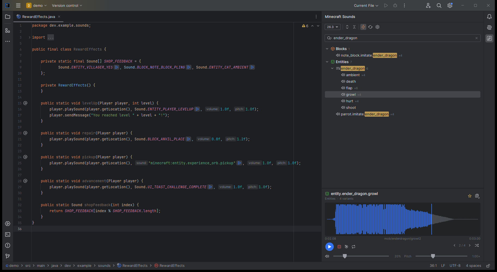
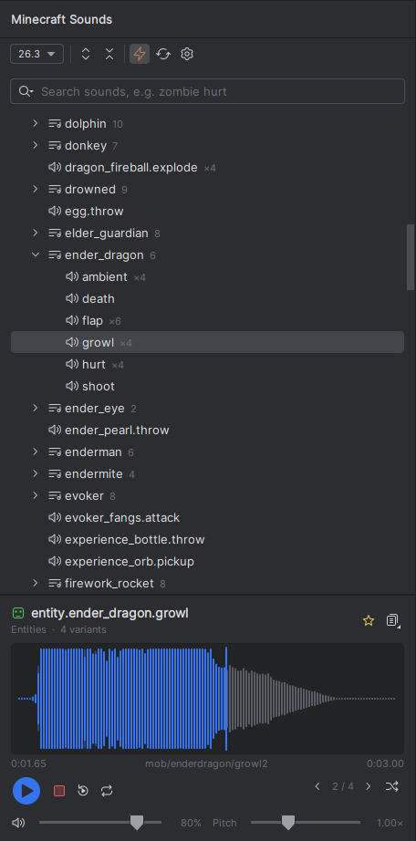
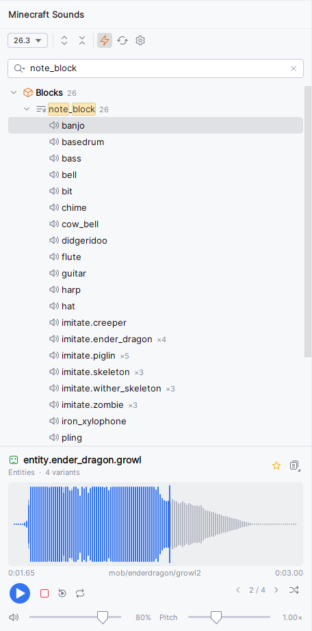
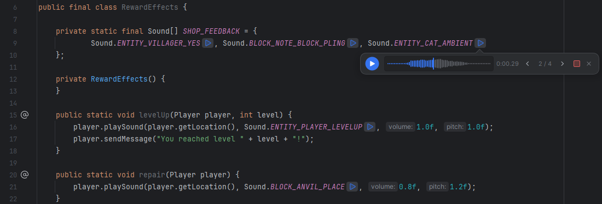

<p align="center">
  
</p>

<h1 align="center">Minecraft Sound Browser</h1>

<p align="center">
  Browse, search and play every vanilla Minecraft sound right inside IntelliJ IDEA —
  and hear the sounds you reference in code with one click right in the editor.
</p>

<p align="center">
  <a href="https://plugins.jetbrains.com/plugin/35906-minecraft-sound-browser"></a>
  <a href="https://plugins.jetbrains.com/plugin/35906-minecraft-sound-browser"></a>
  <a href="https://github.com/DverkaSK/minecraft-sound-browser/actions/workflows/build.yml"></a>
  <a href="LICENSE"></a>
</p>

<p align="center">
  
</p>

## Features

**Sound browser**
- Every sound event of any Minecraft release since 1.7.2 (and snapshots, if you want them)
- Organized into categories and groups — *Blocks › anvil › place*, *Entities › zombie › hurt*, *Music Discs*, *Interface*…
- Instant search that understands every naming style: `zombie hurt`, `entity.zombie.hurt`,
  `ENTITY_ZOMBIE_HURT`, `Sound.ENTITY_ZOMBIE_HURT`, `minecraft:entity.zombie.hurt`
- Favorites for the sounds you use most

<p align="center">
  
  &nbsp;&nbsp;
  
</p>

**Player**
- Interactive waveform: click or drag to seek
- Play / pause, stop, replay, loop
- Step through every variant of a sound event, or pick a weighted random one like the game does
- Live volume and pitch (0.5×–2.0×) that matches the `pitch` argument of `playSound`
- Per-file `volume` and `pitch` from `sounds.json` are applied, so the preview sounds like in-game

**Editor integration**

<p align="center">
  
</p>

- A ▶ button right after every sound reference (several sounds on one line each get their own):
  - `Sound.ENTITY_PLAYER_LEVELUP` — Bukkit, Spigot, Paper; pre-1.9 names like `Sound.LEVEL_UP` too
  - `SoundEvents.ENTITY_PLAYER_LEVELUP` — Fabric (Yarn)
  - `SoundEvents.PLAYER_LEVELUP` — Mojang mappings (NeoForge, Forge, Paper internals)
  - `SoundEvent.X` — Minestom, `SoundTypes.X` — Sponge
  - any of these statically imported (`import static org.bukkit.Sound.*`)
  - `"entity.player.levelup"` / `"minecraft:entity.player.levelup"` — Adventure, commands, data
- Your own sounds: everything defined in the project's `assets/<namespace>/sounds.json`
  (mods, resource packs) — `ModSounds.BOSS_ROAR`, `"mymod:boss.roar"` and the entries of
  `sounds.json` itself — played straight from the project's `.ogg` files
- Java, Kotlin, Groovy, Scala, JSON and plain text (associate `.mcfunction` with *Text* to get buttons there)
- Clicking it opens a compact mini player under the line: play/pause, seekable waveform, time, stop, close
- Copy a sound as a key, namespaced key, Bukkit constant, `player.playSound(...)` call,
  Adventure `Sound.sound(...)` or `/playsound` command — with your current pitch filled in

**Lightweight and offline-friendly**
- Nothing is bundled: sounds are fetched on demand from Mojang's official servers
  using the IDE's proxy settings, verified by SHA-1 and cached
- Everything you have played once works offline
- Works in every IntelliJ-based IDE (2024.3+); support for each language switches on automatically

## Installation

- **Marketplace:** <kbd>Settings</kbd> › <kbd>Plugins</kbd> › <kbd>Marketplace</kbd> › search for **Minecraft Sound Browser** › <kbd>Install</kbd>
  (or [open it on JetBrains Marketplace](https://plugins.jetbrains.com/plugin/35906-minecraft-sound-browser))
- **Manually:** download the latest ZIP from [Releases](https://github.com/DverkaSK/minecraft-sound-browser/releases) and use
  <kbd>Settings</kbd> › <kbd>Plugins</kbd> › <kbd>⚙️</kbd> › <kbd>Install Plugin from Disk…</kbd>

## Usage

Open **View › Tool Windows › Minecraft Sounds** (or **Tools › Minecraft Sound Browser**).

| Action | How |
| --- | --- |
| Play a sound | Select it (with *Play on Selection* on), double-click, or press <kbd>Enter</kbd> |
| Play / pause | <kbd>Space</kbd> in the list, or the round button |
| Seek | Click or drag on the waveform |
| Search | Just start typing in the list |
| Copy / favorite | Right-click a sound, or use the buttons in the player header |
| Change version | Version selector in the toolbar |
| Play from code | Click ▶ after a sound reference — a mini player opens under the line (<kbd>Space</kbd> pauses, <kbd>Esc</kbd> closes) |

Settings live under **Settings › Tools › Minecraft Sound Browser**. Inline buttons can be toggled in
**Settings › Editor › Inlay Hints › Other**; optional gutter icons in **Settings › Editor › General › Gutter Icons**.
The play buttons use the IDE accent color; pick your own with **Custom play button color** in the plugin settings.

## Building from source

Requires JDK 21.

```bash
./gradlew buildPlugin        # plugin ZIP in build/distributions
./gradlew runIde             # sandbox IDE with the plugin
./gradlew test               # unit and platform tests
./gradlew verifyPlugin       # JetBrains Plugin Verifier
```

## Publishing

When a GitHub release is published, the [`release`](.github/workflows/release.yml) workflow builds the
plugin ZIP and attaches it to the release. If the secrets below are set, it also publishes the plugin to
JetBrains Marketplace:

| Secret | Purpose |
| --- | --- |
| `PUBLISH_TOKEN` | JetBrains Marketplace [permanent token](https://plugins.jetbrains.com/author/me/tokens) |
| `CERTIFICATE_CHAIN`, `PRIVATE_KEY`, `PRIVATE_KEY_PASSWORD` | [Plugin signing](https://plugins.jetbrains.com/docs/intellij/plugin-signing.html) |

## License

[MIT](LICENSE). The table of pre-1.9 Bukkit sound names is derived from
[XSeries](https://github.com/CryptoMorin/XSeries) (MIT), see [THIRD_PARTY_NOTICES.md](THIRD_PARTY_NOTICES.md).

Not an official Minecraft product. Not approved by or associated with Mojang or Microsoft.
No game assets are included in this repository or the plugin; sounds are downloaded from Mojang's
servers at runtime.
